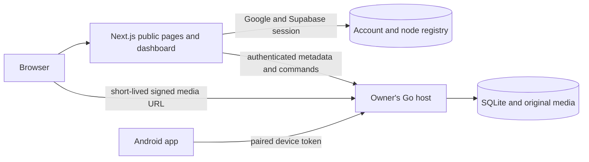

# Fotoro website

This repository contains Fotoro's public website and owner dashboard. The public pages explain the product and its architecture. After sign-in, the dashboard resolves the owner's linked [Fotoro host](https://github.com/Fotoro/Fotoro-Model) and displays the media timeline, storage measurements, devices, pairing, uploads and processing state. The [Android app](https://github.com/Fotoro/Fotoro-Android) shares the same account and host.

## Request architecture

The account registry stores identity and the linked endpoint, not original media. A protected dashboard request carries the account credential; the Go host independently checks the locally bound owner. A paired phone has a restricted, revocable device credential. A Tailscale route provides reachability and is not used as a substitute for API authorization.

## Browsing and delivery

The gallery requests metadata in pages of 100 and renders rows close to the viewport. The Go host supplies small thumbnails, medium previews, optional detail copies and the unchanged original. When a configured Funnel is available, a media list includes short-lived signed URLs so the browser fetches image bytes directly from the host. The authenticated website proxy remains a fallback. The viewer moves between items, supports zoom and requests the original at deep zoom; video reads support seeking by byte range.

Dashboard figures come from host measurements. Media bytes, free disk space, backup-copy state and queue counts are kept distinct. Connectivity checks wake an on-demand host, retry transient reads and retain last-known figures when the route briefly drops.

## Public content and search visibility

The public pages are server rendered with page-specific descriptions and canonical URLs. The sitemap contains public pages and journal articles; dashboard and API routes are excluded from indexing. The journal lives in `site/content/blog.ts`, with no public write route or CMS. `CODEOWNERS` names `@chknaren6` for journal changes. Repository branch protection must require that owner's review if publication rights need to be enforced against other Git collaborators.

The canonical base URL defaults to the reachable `https://fotoro.vercel.app`; a future domain can be supplied with `NEXT_PUBLIC_SITE_URL` after its DNS and redirects work. The site deliberately describes observed capabilities and limits rather than publishing generated claims or synthetic metrics.

## Code map

| Area | Location |
| --- | --- |
| Public pages, metadata, sitemap and robots | `site/app/` |
| Journal entries | `site/content/blog.ts` |
| Dashboard, gallery and viewer | `site/components/dashboard/` |
| Identity, relay and media URL handling | `site/lib/` and `site/app/api/` |
| Database schema and migrations for account records | `site/supabase/` |

See [the site architecture notes](site/README.md) for deployment boundaries and request paths. The website can render public content independently; private dashboard data requires a reachable, authenticated host.
